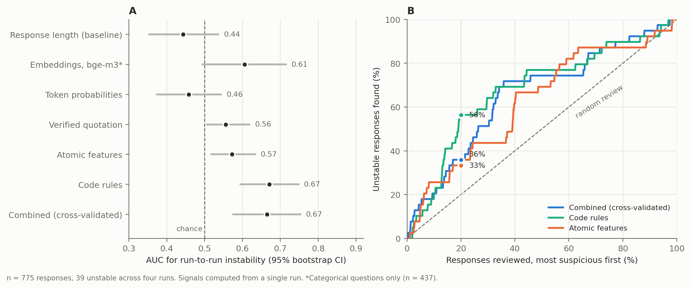

# Flagging responses for human review — draft section

Draft for *From Free Text to Consensus: A Reproducible LLM-Based Method for Round-by-Round
Analysis of Delphi Studies*. Numbers come from `tools/senales.py` and `tools/fig_senales.py`
(run `Resultados_v4f_k4`); the design and every amendment are dated in
`docs/experimento_senales.md`. Text marked **[PENDING]** waits for the human-coded validation
sheets.

---

## Methods

### Rationale

A generative model used as a coder is not deterministic. With temperature 0 and a fixed seed,
repeated runs of the same prompt still disagree on a small share of labels, and the model gives
no reliable account of why it chose a label. Reviewing every label by hand would remove the
benefit of automation. We therefore asked which signals, computed from a **single** run,
identify the responses a person should review. The design (signals, outcomes, evaluation) was
fixed in writing on 9 November 2026, before any signal was computed; later changes were made
only against the run-to-run outcome and are logged with their dates.

### Signals

Every signal is a suspicion score computed from one classification run; higher means more
suspicious.

| Signal | Computation | Calls to the LLM |
|---|---|---|
| Response length (baseline) | shorter response = more suspicious | none |
| Embeddings | cosine similarity between the response and the text of each option (bge-m3 via Ollama 0.18.3, model digest `790764642607`); score = similarity of the best option minus that of the assigned option. Categorical questions only | none |
| Code rules | (i) a numeric question whose response contains a number but receives no band; (ii) the assigned option has a more general or more specific sibling in the taxonomy (*No* / *No, subjective…*) | none |
| Token probabilities | margin, in log-probability, between the token that encodes the chosen option (or band) and the next alternative, read from the model's `logprobs` | none (same call) |
| Verified quotation | a separate call shows the assigned label and asks for the shortest verbatim fragment that supports it; code checks that the fragment exists in the response (fuzzy match); an empty quotation is maximal suspicion | 1 per response |
| Atomic features | a separate call, **without** the label, records stance (yes / no / conditional / none), whether a number is given, whether the response says the answer depends on something, and whether it is on topic; fixed rules count contradictions with the label (e.g. a bare *No* when the response is conditional, a number with no band) | 1 per response |
| Combined | logistic regression on all signals, scored by 5-fold cross-validation | — |

Missing values were assigned maximal suspicion. Ten texts could not be embedded (the
server returned NaN; a fixed rule retried content-preserving variants, which recovered 12).

### Outcomes

1. **Run-to-run instability** (available without human labels): the main-axis label differs
   among four runs of the identical prompt — the three production runs and a fourth run that
   also requested log-probabilities. For numeric questions the label is the band derived by code
   from the extracted number, the same band used to compute consensus.
2. **Deviation from the vote**: the fourth run disagrees with the majority of the other three.
3. **Error against human coders** **[PENDING]**: the voted label differs from the label assigned
   by an expert coder on a random sample of 244 responses (seed 42) **[VERIFY: whether the coder
   saw the model labels]**.

Signal thresholds and the combination were never tuned on outcome 3.

### Evaluation

For each signal we report the area under the ROC curve (AUC) with a 95% bootstrap confidence
interval (2,000 resamples), and an effort–detection curve: responses are sorted from most to
least suspicious, and the curve shows the share of positive cases found as a function of the
share of responses reviewed. We summarise it as the share found after reviewing 20%.

---

## Results

Of 775 valid responses, 39 (5.0%) changed label across the four runs and 21 (2.7%) were labeled
by the fourth run differently from the majority of the other three. The unstable responses were
of two kinds. Ten were numeric answers whose period was ambiguous (*"4 hours into two days"*,
*"an hour and a half, three days a week"*), read as hours per session in some runs and per
week in others. Twenty-nine were categorical; in 17 of them the runs disagreed only on the
qualifier within the same stance (*No* vs *No, subjective…*), which does not affect consensus,
measured at the stance level for yes/no questions. Five changed stance and seven belonged to
questions without a yes/no stance.

No signal computed from a single run identified unstable responses well (Figure X, panel A).
Code rules performed best (AUC 0.67, 95% CI 0.59–0.75): reviewing the 20% of responses they
ranked most suspicious found 56% of unstable ones (panel B). Combining all signals did not
improve on them (AUC 0.67, 0.57–0.76; 36% found at 20%). Atomic features (0.57, 0.52–0.64) and
verified quotation (0.56, 0.50–0.62) were weakly informative. Embeddings, restricted to
categorical questions, reached 0.61 with a confidence interval that included chance
(0.49–0.72). Token probabilities did not discriminate (0.46, 0.37–0.55): after reasoning, the
model was near-certain of every label — the log-probability margin never fell below 8 (median
13.2), including on responses whose label changed in other runs.

Two alarms are notable because they explain themselves. In 36 responses the model, shown its
own label, quoted nothing from the text that supported it; 5 of these were unstable (14%,
almost three times the base rate). Atomic features contradicted the label in 53 responses, 8 of
them unstable (15%).

**[PENDING]** Error against the expert coder: per-signal AUC and effort–detection curve on the
validation sample, and agreement between model and expert (and between two experts, as the
ceiling).

---

## Discussion points

- Repeating the run and voting remains necessary: no single-run signal replaces it. The model's
  confidence, in particular, is not a usable alarm for a reasoning model at temperature 0.
- The cheapest signals were the most useful: two code rules derived from the structure of the
  taxonomy. Most residual instability came from the instrument (ambiguous periods in numeric
  answers, nested options), not from the model's reading of the text.
- Embeddings measure topic, not stance; they cannot separate *yes* and *no* about the same
  subject, and were close to chance here.
- Auditability rests on three verifiable elements, not on the model's reasoning: each label with
  a quotation checked by code, a measured rule that decides what is reviewed, and a person who
  reviews those cases.

---

**Figure X.** Signals for selecting responses for human review. (A) AUC of each single-run
signal for predicting run-to-run instability, with 95% bootstrap confidence intervals; the
dashed line marks chance. (B) Effort–detection curves for the three best signals: share of
unstable responses found as a function of the share reviewed, most suspicious first; dots mark
20% reviewed. n = 775 responses, 39 unstable across four runs. *Embeddings: categorical
questions only (n = 437).

